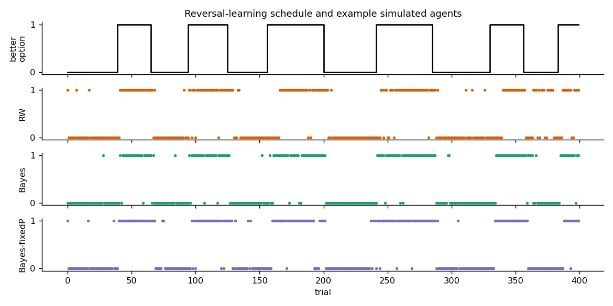
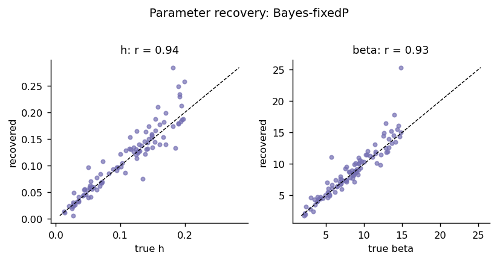
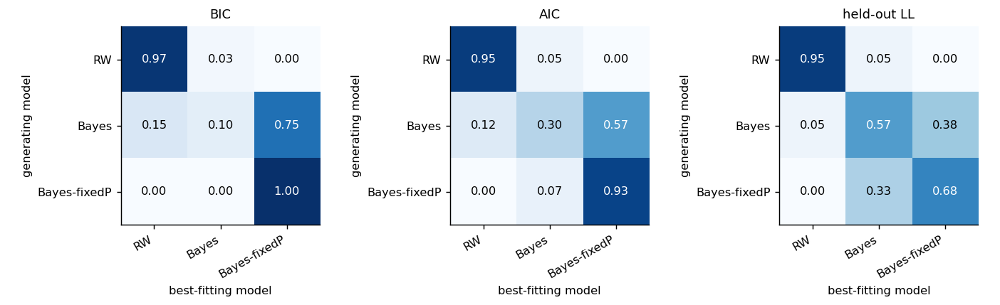
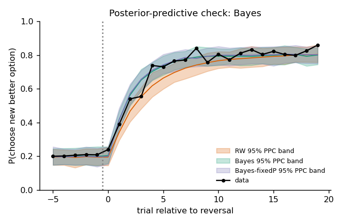
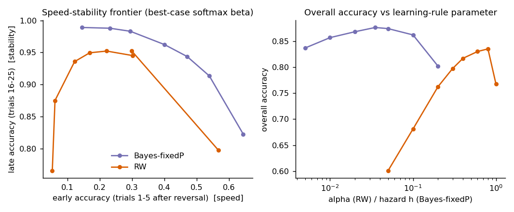

# Bayesian vs Rescorla–Wagner learning in probabilistic reversal learning

A simulation-validated modelling pipeline that compares two accounts of how an agent learns
which of two options is currently rewarded when the contingencies **reverse**:

| | model | learning rule | free parameters |
|---|---|---|---|
| **RW** | Rescorla–Wagner / Q-learning | model-free delta rule, fixed learning rate | α, β |
| **Bayes** | Bayesian change-point observer | model-based hidden-state filter | h, p, β |
| **Bayes-fixedP** | same, told the true reward probability | model-based hidden-state filter | h, β |

The pipeline runs four stages: **(1)** parameter recovery, **(2)** model recovery, **(3)** fitting, model comparison
(AIC, BIC, held-out log-likelihood) and posterior-predictive checks, **(4)** a speed–stability benchmark of the two
learning rules. Everything is reproducible from one command and one seed.

> **Scope note.** All results below come from **simulated agents with known ground truth**; no human or animal data
> are bundled. That is deliberate – recovery analyses are only possible when the truth is known – but it means the
> results validate the *method* and illustrate model behaviour; they are not empirical findings about a biological
> population. To analyse real data, see [Using your own data](#using-your-own-data).

---

## 1. The behavioural task

Two options (0 and 1). On every trial one option is the *better* option and pays off with probability
**0.8**; the other pays off with probability **0.2**. After a block of 25–45 trials (uniformly random) the identity of
the better option **reverses**, with no cue. Each session has 400 trials (≈ 10 reversals). The agent chooses one option
per trial and observes only that option's binary outcome.



A good agent must (i) integrate noisy evidence to identify the better option, and (ii) notice that the contingencies
have changed and switch – without being thrown off by the 20 % of unlucky outcomes that occur even for the better option.

## 2. The models

Both models use the **same softmax choice rule** on a signed value difference, so differences in fit are attributable to
the *learning rule*.

### Rescorla–Wagner (RW)

Only the chosen option $c_t$ is updated, with a **fixed** learning rate $\alpha$:

$$Q_{t+1}(c_t) = Q_t(c_t) + \alpha\,\big(r_t - Q_t(c_t)\big), \qquad Q_0 = 0.5$$

$$P(c_t = 1) = \sigma\big(\beta\,[Q_t(1) - Q_t(0)]\big)$$

Evidence about an option decays geometrically, $(1-\alpha)^n$, no matter how surprising the outcomes are. A single
learning rate must therefore trade off **speed** (high α: switches quickly after a reversal, but is thrown by unlucky
outcomes) against **stability** (low α: ignores noise, but is slow to follow a reversal).

### Bayesian change-point observer

The agent holds a generative model: a hidden state $s_t \in \{0,1\}$ says which option is currently better; the better
option pays off with probability $p$, the other with $1-p$; and the state flips on each trial with probability $h$
(the believed reversal hazard). With belief $b_t = P(s_t = 1 \mid \text{history})$ and likelihoods
$L_1 = P(r_t \mid c_t, s_t = 1)$, $L_0 = P(r_t \mid c_t, s_t = 0)$:

$$b_t^{+} = \frac{b_t L_1}{b_t L_1 + (1-b_t) L_0}, \qquad b_{t+1} = (1-h)\,b_t^{+} + h\,(1-b_t^{+})$$

$$\Delta EV_t = (2b_t - 1)(2p - 1), \qquad P(c_t = 1) = \sigma\big(\beta\,\Delta EV_t\big)$$

Two properties distinguish it from RW:

1. **Structure.** One outcome updates the belief about *both* options (it knows they are anti-correlated).
2. **Adaptive effective learning rate.** Evidence adds in log-odds (±log(p/(1−p)) ≈ ±1.39 per outcome for p = 0.8) and the hazard
   caps confidence at $|\mathrm{logit}\,b| \le \log\frac{1-h}{h}$. A confident belief therefore tolerates one isolated loss, but a
   few consecutive disconfirming outcomes flip it quickly (about three for h = 0.035).

`Bayes` infers $p$ as a free parameter; `Bayes-fixedP` fixes $p = 0.8$ (an observer who has been told the reward contingencies),
which gives it the same number of parameters as RW.

## 3. Methods

| Step | Implementation (`src/revlearn/`) |
|---|---|
| Simulation | `task.py`, `models.py::simulate` – the simulator and likelihood share one update rule; `tests/` asserts $\sum\log P_{\text{chosen}}$ from the simulator equals the likelihood. |
| Estimation | `fitting.py::fit` – multi-start L-BFGS-B on the bounded parameter box; **MLE** (default) or **MAP** (`method="map"`, weakly-informative Beta/Gamma priors). AIC/BIC/held-out LL all use MLE. |
| Parameter recovery | 100 agents/model, parameters drawn from broad ranges, 400 trials, MLE refit; Pearson/Spearman, bias, RMSE, fraction of fits at a bound. |
| Model recovery | 40 agents/generating model, **all three** models fit to every dataset; winner by BIC, AIC and held-out LL → confusion matrices. |
| Held-out log-likelihood | 5-fold CV over **contiguous trial blocks**: parameters are fit on the training trials only; the score is the one-step-ahead predictive log-probability of the held-out choices (latent state filtered through earlier trials, as for a real agent). |
| Posterior-predictive checks | Adaptive random-walk Metropolis (600 warm-up + 1000 draws, logit-transformed box, acceptance 0.22–0.36) per subject × model. 100 replicated sessions per subject, each with its own posterior draw, run *free* in the subject's schedule. Checked: six behavioural statistics and the reversal-aligned learning curve. Posterior-predictive p-values use mid-p ties; "failed" = group-level p < 0.025 or > 0.975. |
| Speed–stability benchmark | `adaptation.py` – grid over learning-rule parameter × softmax β; for each learning-rule setting β is chosen to maximise accuracy, so each rule is compared at its *best-case* decision noise. 100 sessions per cell, identical schedules across cells. |

## 4. Results

Generated by `python scripts/run_all.py --seed 2024` (≈ 6 min on one CPU core; Python 3.12.3, NumPy 2.4.4, SciPy 1.17.1).
Full logs: [`results/run_log.txt`](results/run_log.txt); tables in [`results/tables/`](results/tables).
Other platforms/library versions may differ in the 2nd–3rd decimal place.

### 4.1 Parameter recovery (100 agents per model, 400 trials)

| model | parameter | Pearson r | Spearman ρ | bias | fits at bound |
|---|---|---|---|---|---|
| RW | α | **0.97** | 0.97 | +0.01 | 1 % |
| RW | β | 0.80 | 0.96 | +0.94 | 3 % |
| Bayes-fixedP | h | **0.94** | 0.96 | +0.006 | 0 % |
| Bayes-fixedP | β | **0.93** | 0.96 | +0.46 | 0 % |
| Bayes (p free) | h | 0.65 | 0.65 | −0.003 | 2 % |
| Bayes (p free) | p | 0.72 | 0.73 | −0.001 | 11 % |
| Bayes (p free) | β | 0.46 | 0.46 | +3.34 | **37 %** |
| Bayes (p free) | k = β(2p−1) | 0.84 | 0.78 | – | – |

The optimiser reached a log-likelihood at least as high as the true generating parameters in 100 % of fits, so the
imperfect recovery below is a property of the model, not of the optimiser.



**Identifiability limit.** In the free-*p* Bayesian model, $p$ and $\beta$ enter the choice rule only through the product
$k = \beta(2p-1)$ and trade off against one another; $p$ is constrained only weakly through the belief dynamics. With 400 trials,
$h$, $p$ and $\beta$ are therefore *not* individually well-identified (r = 0.46–0.72), although the composite $k$ is (r = 0.84). Do not interpret
individual parameters of the free-*p* model from a single 400-trial session; `Bayes-fixedP` is the version whose parameters can be interpreted.

### 4.2 Model recovery (40 agents per generating model)

P(best-fitting model | generating model):

| generating ↓ / winner → | BIC: RW | Bayes | Bayes-fixedP | Held-out LL: RW | Bayes | Bayes-fixedP |
|---|---|---|---|---|---|---|
| **RW** | **0.98** | 0.02 | 0.00 | **0.95** | 0.05 | 0.00 |
| **Bayes** (p free) | 0.15 | 0.10 | **0.75** | 0.05 | **0.57** | 0.38 |
| **Bayes-fixedP** | 0.00 | 0.00 | **1.00** | 0.00 | 0.32 | **0.68** |

(AIC: [`results/tables/confusion_AIC.csv`](results/tables/confusion_AIC.csv).)
The RW-vs-Bayesian *family* distinction is recovered well: RW data are labelled RW 98 % (BIC) / 95 % (held-out), and Bayesian data are
labelled a Bayesian variant 85–100 % (BIC) / 95–100 % (held-out). Separating the *two Bayesian variants* is much harder, and BIC (which penalises the
extra parameter) mostly prefers the simpler one even when the free-*p* model generated the data.



### 4.3 Fitting, comparison and posterior-predictive checks on a labelled cohort

Cohort: 20 RW agents + 20 Bayesian (free-*p*) agents, 400 trials each (`data/simulated_cohort.csv`; true parameters in `data/simulated_cohort_true_params.csv`).

**Per-subject winners.** RW agents: RW wins 20/20 by BIC, AIC and held-out LL. Bayesian agents: a Bayesian variant wins 20/20 by all three criteria
(BIC: 18 Bayes-fixedP + 2 Bayes; held-out LL: 10 + 10).

**Group comparison within each generating group** (this, not the pooled table, is the meaningful comparison: a pooled sum over a 50/50 mixture simply reflects the mixture – see `model_comparison_group.csv`):

| data generated by | model | Σ BIC (20 agents) | held-out LL / trial |
|---|---|---|---|
| RW | **RW** | **5179.7** | **−0.316** |
| RW | Bayes | 5885.3 | −0.360 |
| RW | Bayes-fixedP | 6101.8 | −0.382 |
| Bayes | RW | 6439.3 | −0.397 |
| Bayes | Bayes | 5904.7 | **−0.355** |
| Bayes | **Bayes-fixedP** | **5818.9** | **−0.355** |

**Posterior-predictive checks** (group level, 6 statistics, 95 % two-sided; "failed" = observed group mean outside the replicated 95 % interval):

| data generated by | RW | Bayes | Bayes-fixedP |
|---|---|---|---|
| RW | **0 / 6** | 3 / 6 | 5 / 6 |
| Bayes | 4 / 6 | **0 / 6** | **0 / 6** |

The checks are *diagnostic*: RW fails on Bayesian-generated data in P(shift | unrewarded) (observed 0.61 vs replicated 0.49 [0.47, 0.51]), early post-reversal accuracy,
overall accuracy and switch rate. Across individual subject × statistic cells, the model matching the generating process (RW on RW data, Bayes on Bayes data) produced extreme p-values in 1–3 % of cells (nominal 5 %),
whereas RW on Bayesian data and the Bayesian variants on RW data produced 15–21 %. (Group-level checks are not corrected for multiple comparisons.)



### 4.4 Do Bayesian learners adapt faster? Speed–stability benchmark



At each rule's best-case decision noise (400-trial sessions, p = 0.8, 100 sessions per cell):

| learning rule | best setting | accuracy | acc., trials 1–5 post-reversal | acc., trials 16–25 | trials to reach P(new best) ≥ 0.5 |
|---|---|---|---|---|---|
| RW | α = 0.8 | 0.835 | 0.30 | 0.953 | 5 |
| Bayes-fixedP | h = 0.035 | **0.877** | **0.40** | **0.962** | **4** |

At *matched speed* (early accuracy ≈ 0.30) the Bayesian observer (h = 0.02) is more stable than RW (α = 0.6): late accuracy 0.983 vs 0.945. Over the
overlapping range of early accuracy the Bayesian frontier lies above the RW frontier, so no single fixed α reproduces its speed–stability combination.

## 5. How to read the "Bayesian adapts faster" result

The commonly quoted expectation – that Bayesian learners adapt to reversals faster than a fixed-learning-rate RW learner – is **conditional**, and this
repository shows the conditions:

* It holds here because the Bayesian observer **encodes the task's structure** (two anti-correlated options, occasional reversals, known reward
  probability). It is a statement about *knowing the structure*, not about "being Bayesian" in itself. A stationary Beta–Bernoulli learner has an effective
  learning rate that shrinks as 1/n and would be expected to adapt *more slowly* than RW (a standard analytical result; not simulated here). An RW variant that also updates the unchosen option (counterfactual update) or uses
  separate learning rates for gains and losses can close part of the gap; **those variants are not tested here**.
* The advantage is a few accuracy points (≈ 4 percentage points at best-case noise), not an order of magnitude.
* The task has a **constant** reversal hazard. "Adapting to volatility" in the strict sense (changing the learning rate when the reversal rate changes) would
  require blocks with different reversal frequencies, which this task does not manipulate.
* With real data, which model wins depends on the true generative process; Stage 2 shows what the comparison can and cannot resolve (RW vs Bayesian: yes;
  free-*p* vs fixed-*p* Bayesian: only weakly).

## 6. Limitations

* Simulated data only; no biological data are analysed.
* Subjects are fit independently (no hierarchical pooling). MCMC uses a single chain per subject/model and is checked by acceptance rate only (no R-hat / ESS).
* RW is the minimal "standard" version (chosen-option update, one learning rate, no perseveration). Richer RW variants are natural comparators.
* Held-out and BIC criteria can disagree (Stage 2/3 show this for the two Bayesian variants); report several criteria rather than one.
* Benchmark (Stage 4) numbers have no confidence intervals; they average 100 sessions per cell and the best-case β sits at the edge of the grid (30).

## 7. Repository structure

```
.
├── README.md
├── requirements.txt / pyproject.toml / LICENSE
├── src/revlearn/
│   ├── task.py          # reversal-learning schedule generator
│   ├── models.py        # RescorlaWagner, BayesianObserver, BayesianObserverFixedP (+ priors, simulators)
│   ├── fitting.py       # multi-start MLE/MAP, contiguous-block CV, adaptive Metropolis sampler
│   ├── analysis.py      # behavioural statistics, reversal curves, posterior-predictive checks
│   ├── adaptation.py    # speed-stability benchmark
│   ├── io.py            # CSV loading / saving
│   ├── workers.py       # picklable worker functions + parallel map
│   └── plotting.py
├── scripts/
│   ├── run_all.py                 # stages 1-4 (use --n-jobs 0 for all cores, --quick for a smoke test)
│   ├── 01_parameter_recovery.py
│   ├── 02_model_recovery.py
│   ├── 03_fit_compare_ppc.py      # also accepts --data your_trials.csv
│   └── 04_adaptation_benchmark.py
├── tests/test_core.py   # 15 tests: simulator == likelihood, hand-computed updates, recovery, CV, MCMC
├── data/                # simulated cohort + ground-truth parameters
└── results/             # figures/, tables/, run_log.txt from the run reported above
```

## 8. Reproduce

```bash
python -m venv .venv && source .venv/bin/activate
pip install -r requirements.txt
pip install -e .                      # optional; the scripts also run without it
pytest -q                             # 15 tests
python scripts/run_all.py --n-jobs 0  # full pipeline, seed 2024
python scripts/run_all.py --quick     # 1-minute smoke test (not for reporting)
```

Programmatic use:

```python
import numpy as np
from revlearn import MODELS, TaskConfig, make_schedule
from revlearn.fitting import fit

rng = np.random.default_rng(0)
sched = make_schedule(TaskConfig(), rng)
choices, rewards, _ = MODELS["RW"].simulate([0.3, 5.0], sched, rng)
print(fit(MODELS["RW"], choices, rewards, method="mle", rng=rng).params)
```

### Using your own data

Provide a long-format CSV with one row per trial:

| column | required | meaning |
|---|---|---|
| `subject`, `trial` | yes | subject id, trial index |
| `choice` | yes | 0 / 1, option chosen |
| `reward` | yes | 0 / 1, outcome received |
| `best_option` | for PPC | 0 / 1, objectively better option on that trial |
| `true_model` | no | ground-truth label (simulated cohorts only) |

```bash
python scripts/03_fit_compare_ppc.py --data my_trials.csv --p-high 0.75 --n-jobs 0
```

Notes: `Bayes-fixedP` assumes p = 0.8 (edit `MODELS` in `models.py` if your task differs); the cross-validation and PPC statistics assume trials per session ≥ 100
and blocks ≥ 25 trials (late-block statistic uses trials 16–25 after a reversal).

## 9. References

* Rescorla, R. A., & Wagner, A. R. (1972). A theory of Pavlovian conditioning. In *Classical Conditioning II*.
* Hampton, A. N., Bossaerts, P., & O'Doherty, J. P. (2006). The role of the ventromedial prefrontal cortex in abstract state-based inference during decision making in humans. *J. Neurosci.*
* Costa, V. D., Tran, V. L., Turchi, J., & Averbeck, B. B. (2015). Reversal learning and dopamine: a Bayesian perspective. *J. Neurosci.*
* Daw, N. D. (2011). Trial-by-trial data analysis using computational models. In *Decision Making, Affect, and Learning*.
* Wilson, R. C., & Collins, A. G. E. (2019). Ten simple rules for the computational modeling of behavioral data. *eLife*.
* Palminteri, S., Wyart, V., & Koechlin, E. (2017). The importance of falsification in computational cognitive modeling. *Trends Cogn. Sci.*
* Gelman, A., Meng, X.-L., & Stern, H. (1996). Posterior predictive assessment of model fitness via realized discrepancies. *Statistica Sinica*.
* Akaike, H. (1974); Schwarz, G. (1978) – AIC and BIC.

## License

MIT
